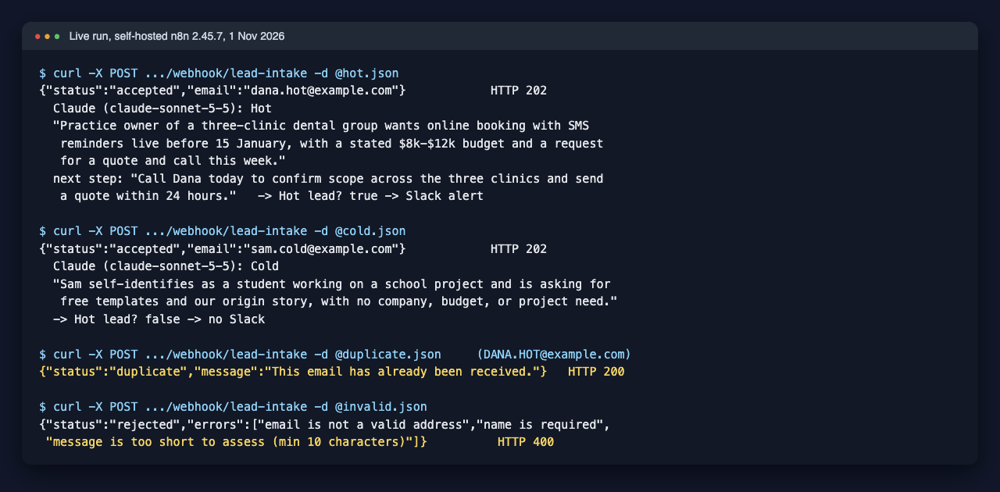
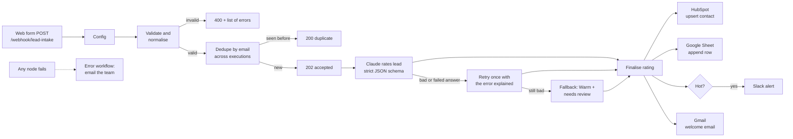

# n8n AI Lead Pipeline

A production-style n8n workflow for inbound leads. A web form posts to a webhook, the lead is validated and de-duplicated, Claude rates it Hot, Warm or Cold with a one-line reason, and then the contact is upserted in HubSpot, logged to a Google Sheet, a Slack alert goes out for Hot leads, and the lead gets a welcome email. A separate error workflow emails the team if any step fails.



*A real run on self-hosted n8n with real Claude calls: the hot lead is rated Hot and routed to Slack, the student is rated Cold, the repeat email is caught as a duplicate and the broken submission is rejected with every error listed.*

## How it works



| Step | Node | What it does |
|---|---|---|
| 1 | Lead webhook | `POST /webhook/lead-intake`, JSON body: `name`, `email`, `message`, optional `company`, `budget`, `phone`, `source`, and a hidden `website` honeypot field |
| 2 | Config | One Set node holding every value a client changes: business name and profile, Sheet ID and tab, Slack channel |
| 3 | Validate and normalise | Trims and collapses whitespace, lowercases the email, splits first/last name, caps field lengths, rejects missing or malformed fields and filled honeypots. Returns `400` with every error at once |
| 4 | Dedupe by email | n8n's Remove Duplicates node in "seen in previous executions" mode, keyed on the normalised email, so `Dana@Example.com` and `dana@example.com` count as the same lead. Duplicates get `200 {"status":"duplicate"}` |
| 5 | Respond 202 accepted | The form gets its answer straight away; the slow AI and CRM work carries on after the response |
| 6 | Claude: rate lead | HTTP Request to the Anthropic Messages API (`claude-sonnet-5-5`) with a JSON schema output (`rating` is an enum of Hot, Warm, Cold, plus `reason` and `next_step`). The node retries network and 5xx errors 3 times, then passes any final error on instead of failing the run |
| 7 | Parse rating / Rating OK? | Checks the answer: refusal, cut-off output, invalid JSON, a rating outside the enum and an empty reason are all caught |
| 8 | Build retry request / Claude: retry / Parse retry | One more attempt, telling the model what was wrong with the first answer |
| 9 | Finalise rating | Uses the good answer, or falls back to **Warm with needs review = yes**, so a broken AI step never drops a lead and never wrongly files a real buyer as Cold. Also builds the Sheet row, Slack text and welcome email |
| 10 | HubSpot: upsert contact | Creates or updates the contact by email, with first/last name, company, message, lifecycle stage `lead`, and three custom properties: `ai_lead_rating`, `ai_lead_reason`, `ai_needs_review` |
| 11 | Google Sheets: log lead | Appends one row per lead (12 columns, see below) |
| 12 | Hot lead? / Slack: alert sales | Only Hot leads reach Slack, with the reason and a suggested next step |
| 13 | Gmail: welcome email | Plain-text acknowledgement to the lead |
| - | Error workflow | Error Trigger, then an email naming the workflow, the failed node, the error and a link to the execution |

## Design choices

- **The logic is real code with tests, not just canvas clicks.** Validation, prompt building, parsing, fallback and message text live in `src/*.js`. `scripts/build-workflow.js` pastes that exact source into the n8n Code nodes and writes `workflows/*.json`, and a test fails if the exported workflow drifts from the source.
- **Structured output plus validation.** The JSON schema makes a well-formed answer the normal case; the parser still checks everything because refusals, cut-offs and API errors can't be prevented by a schema.
- **Fail soft on AI, fail loud on systems.** An AI problem degrades to Warm + needs review and the lead still flows on. A HubSpot, Google or Slack failure stops the run and triggers the error workflow, because silently losing a CRM write is worse.
- **Form text is treated as data.** The lead is wrapped in `<lead>` tags and the system prompt tells the model to ignore any instructions inside it.
- **Fast webhook response.** The form gets `202` before the AI call, so a slow model never makes the website hang.

## Setup

You need an n8n instance (Cloud or self-hosted, tested on n8n 2.45), an Anthropic API key, and free HubSpot, Slack and Google accounts.

1. **Import** `workflows/error-alert.json` and `workflows/ai-lead-pipeline.json` (Workflows, Import from File).
2. **Credentials** (create in n8n, then pick them on the nodes):
   - Anthropic: on both "Claude" HTTP nodes, Authentication is already set to the predefined `Anthropic` credential type. Paste your API key there.
   - HubSpot OAuth2 (or a private app token): on "HubSpot: upsert contact".
   - Google Sheets OAuth2: on "Google Sheets: log lead".
   - Slack OAuth2: on "Slack: alert sales". Invite the app to the channel.
   - Gmail OAuth2: on "Gmail: welcome email" and on "Gmail: alert ops" in the error workflow.
3. **HubSpot properties.** In HubSpot, Settings, Properties, Contact properties, create `ai_lead_rating` (single-line text or a dropdown with Hot, Warm, Cold), `ai_lead_reason` (multi-line text) and `ai_needs_review` (single-line text).
4. **Google Sheet.** Create a sheet with a tab called `Leads` and this header row:
   `received_at, email, name, company, budget, source, rating, reason, next_step, needs_review, ai_attempts, message`
5. **Config node.** Set `business_name`, `business_profile` (one or two sentences on what you sell and typical deal size, which is what Claude rates against), `google_sheet_id` and `slack_channel`.
6. **Error workflow.** In the error workflow, set the alert address on "Gmail: alert ops" and **publish it**. On n8n 2.x an unpublished error workflow is skipped (the log says it "is not active and cannot be executed"). Then in the main workflow's Settings, pick it as the Error Workflow.
7. **Publish** the main workflow and point your form at the production webhook URL.

Test it:

```bash
curl -X POST https://<your-n8n>/webhook/lead-intake \
  -H 'content-type: application/json' \
  -d @- <<'EOF'
{"name":"Dana Example","email":"dana@example.com","company":"Example Dental Group",
 "budget":"$8,000 to $12,000","message":"Three clinics, need online booking live before January. Can we get a quote this week?"}
EOF
```

`samples/leads.json` has the four test leads used below (hot, cold, duplicate, invalid).

## Tests

```bash
npm test                     # 24 tests, no API keys or network needed
node scripts/build-workflow.js   # regenerate workflows/*.json after editing src/
```

The tests cover validation and normalisation, the Claude request shape, every parse failure case, the Warm fallback, the Sheet/Slack/email text, the structure of both workflows (every connection valid, Slack only on the Hot branch, no credentials or addresses in the export), and they run each Code node's real source with a fake n8n context. GitHub Actions runs them on every push.

## Tested live

**Tested live on 1 November 2026, self-hosted n8n 2.45.7, real Claude calls (`claude-sonnet-5-5`).** The four leads in `samples/leads.json` were posted to the production webhook. HubSpot, Sheets, Slack and Gmail nodes were switched off for this run (no accounts on the test machine), so this run proves everything up to and including the routing into them:

| Lead | Webhook reply | Claude's rating | Path taken |
|---|---|---|---|
| Dental group owner, budget and January deadline | `202 accepted` | **Hot**: "Practice owner of a three-clinic dental group wants online booking with SMS reminders live before 15 January, with a stated $8k-$12k budget and a request for a quote and call this week." | First attempt parsed, Hot branch into Slack |
| Student asking for free templates | `202 accepted` | **Cold**: "Sam self-identifies as a student working on a school project and is asking for free templates..." | First attempt parsed, no Slack |
| Same email as the Hot lead, in capitals | `200 duplicate` | not called | Stopped at Dedupe by email |
| Bad email, no name, two-word message | `400` with all 3 errors listed | not called | Stopped at validation |

Two failure paths were also run for real:

- **AI fallback.** On a first run the Anthropic credential was empty by mistake. Each lead went through 3 HTTP tries, the retry branch, 3 more tries, and came out as `Warm`, `needs review = yes`, reason "Automatic rating failed (API error: Authorization failed - please check your credentials)". The run still finished.
- **Error workflow.** With the HubSpot node switched on but no credential, the main run failed at "HubSpot: upsert contact" and the error workflow ran on its own and produced: subject `n8n failure: AI Lead Pipeline at "HubSpot: upsert contact"`, body naming the error "Node does not have any credentials set" and linking the failed execution.

<!-- CLOUD-RESULTS -->

## Limitations

- **Dedupe memory lives in n8n.** The Remove Duplicates node stores seen emails in n8n's own database (last 10,000). A lead is marked as seen when it passes that node, so if a later step fails, a resubmission is treated as a duplicate; retry the failed execution from n8n instead. For a cross-system rule ("never email anyone already in HubSpot"), swap it for a HubSpot search.
- **The rating is only as good as `business_profile`.** Claude rates against that description. Review a sample of ratings in the Sheet in the first week and tighten the profile.
- **Every valid lead gets the welcome email,** including Cold ones. Move the Gmail node behind an IF if you only want to reply to Hot and Warm.
- **One lead per request.** The webhook expects one JSON object, which is what web forms send. Bulk imports would need a Split Out node first.
- **Free-plan limits apply** on the HubSpot, Slack and Google side (API rate limits, Slack message history), not on the workflow itself.

## Licence

MIT. Part of a small portfolio of tested automation builds, see [ParishSynthMind](https://github.com/ParishSynthMind).
