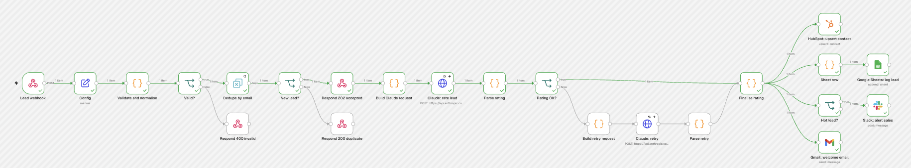
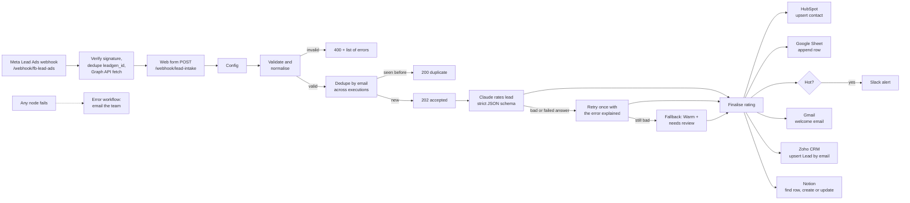
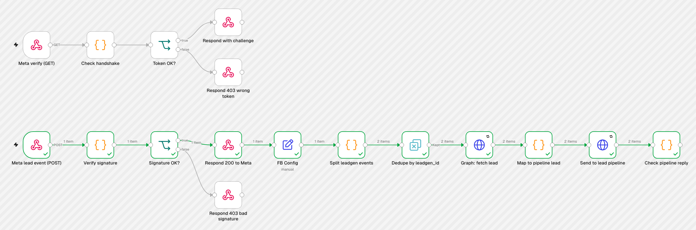
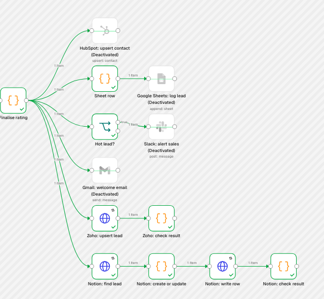
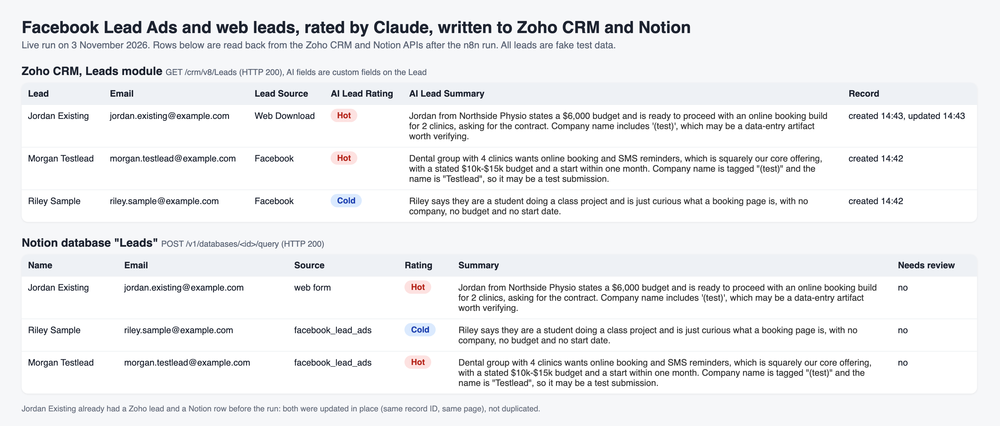
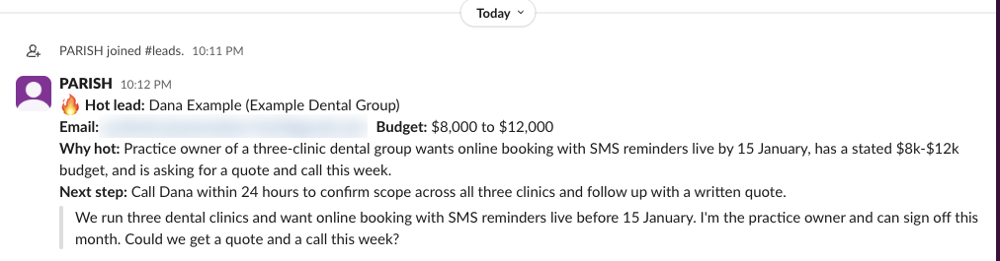
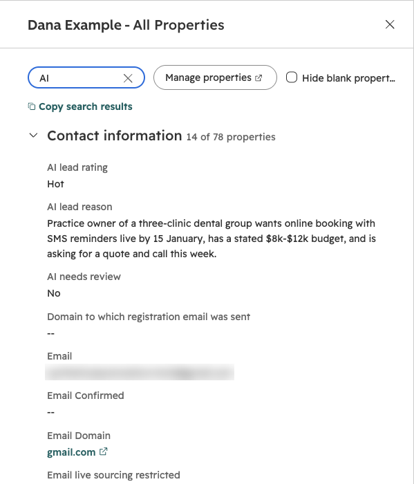
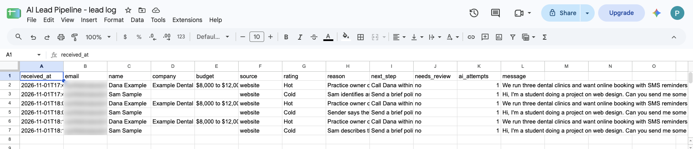

# n8n AI Lead Pipeline

A production-style n8n workflow for inbound leads. A web form posts to a webhook, the lead is validated and de-duplicated, Claude rates it Hot, Warm or Cold with a one-line reason, and then the contact is upserted in HubSpot, logged to a Google Sheet, a Slack alert goes out for Hot leads, and the lead gets a welcome email. A separate error workflow emails the team if any step fails.

**Added 3 November 2026:** a second lead source and two more destinations. Leads from **Facebook / Instagram Lead Ads** forms arrive by Meta webhook (handshake and signature checked), are fetched from the Graph API and fed into the same validation and Claude rating. Every rated lead can also be written to **Zoho CRM** (a Lead, created or updated by email, with the AI rating in custom fields) and to a **Notion** database (one row per lead, updated rather than duplicated). See [Facebook Lead Ads, Zoho CRM and Notion](#facebook-lead-ads-zoho-crm-and-notion).



*A real run on n8n Cloud: the lead is validated, de-duplicated, rated Hot by Claude, upserted to HubSpot, logged to Google Sheets, posted to Slack and sent a welcome email. Screenshots of each destination are under [Tested live](#tested-live).*

## How it works



| Step | Node | What it does |
|---|---|---|
| 1 | Lead webhook | `POST /webhook/lead-intake`, JSON body: `name`, `email`, `message`, optional `company`, `budget`, `phone`, `source`, and a hidden `website` honeypot field |
| 2 | Config | One Set node holding every value a client changes: business name and profile, Sheet ID and tab, Slack channel |
| 3 | Validate and normalise | Trims and collapses whitespace, lowercases the email, splits first/last name, caps field lengths, rejects missing or malformed fields and filled honeypots. Returns `400` with every error at once |
| 4 | Dedupe by email | n8n's Remove Duplicates node in "seen in previous executions" mode, keyed on the normalised email, so `Dana@Example.com` and `dana@example.com` count as the same lead. Duplicates get `200 {"status":"duplicate"}` |
| 5 | Respond 202 accepted | The form gets its answer straight away; the slow AI and CRM work carries on after the response |
| 6 | Claude: rate lead | HTTP Request to the Anthropic Messages API (`claude-sonnet-5-5`) with a JSON schema output (`rating` is an enum of Hot, Warm, Cold, plus `reason` and `next_step`). The node retries network and 5xx errors 3 times, then passes any final error on instead of failing the run |
| 7 | Parse rating / Rating OK? | Checks the answer: refusal, cut-off output, invalid JSON, a rating outside the enum and an empty reason are all caught |
| 8 | Build retry request / Claude: retry / Parse retry | One more attempt, telling the model what was wrong with the first answer |
| 9 | Finalise rating | Uses the good answer, or falls back to **Warm with needs review = yes**, so a broken AI step never drops a lead and never wrongly files a real buyer as Cold. Also builds the Sheet row, Slack text and welcome email |
| 10 | HubSpot: upsert contact | Creates or updates the contact by email, with first/last name, company, message, lifecycle stage `lead`, and three custom properties: `ai_lead_rating`, `ai_lead_reason`, `ai_needs_review` |
| 11 | Google Sheets: log lead | Appends one row per lead (12 columns, see below) |
| 12 | Hot lead? / Slack: alert sales | Only Hot leads reach Slack, with the reason and a suggested next step |
| 13 | Gmail: welcome email | Plain-text acknowledgement to the lead |
| 14 | Zoho: upsert lead / check result | `POST /crm/v8/Leads/upsert` with `duplicate_check_fields: ["Email"]`: name, email, company, phone, Lead Source, message, plus custom fields `AI_Lead_Rating`, `AI_Lead_Summary`, `AI_Next_Step`, `AI_Needs_Review`. The check node fails the run if Zoho rejects a field |
| 15 | Notion: find lead / create or update / write row / check result | Queries the database by email, then updates that row or creates a new one (Name, Email, Company, Phone, Rating, Summary, Next step, Needs review, Source, Budget, Received, Message) |
| - | Error workflow | Error Trigger, then an email naming the workflow, the failed node, the error and a link to the execution |

## Facebook Lead Ads, Zoho CRM and Notion

### Facebook Lead Ads intake (`workflows/facebook-lead-ads.json`)

Meta does not send the lead itself. It sends a small "new lead" ping with a `leadgen_id`, and you fetch the answers from the Graph API with a Page access token. The intake workflow does that and then posts the lead to the main pipeline's own webhook, so Facebook leads get exactly the same validation, dedupe, Claude rating and destinations as web form leads.



| Step | Node | What it does |
|---|---|---|
| 1 | Meta verify (GET) / Check handshake | Answers Meta's subscription check: returns `hub.challenge` only if `hub.verify_token` matches `META_VERIFY_TOKEN`, otherwise `403` |
| 2 | Meta lead event (POST) | Same path, POST, with **Raw Body** on. The signature has to be checked on the exact bytes Meta sent: re-serialised JSON does not match, because Meta escapes `/` and non-ASCII characters |
| 3 | Verify signature | HMAC-SHA256 of the raw body with `META_APP_SECRET`, compared in constant time with `X-Hub-Signature-256`. Missing, malformed or wrong signatures get `403` and no event goes any further |
| 4 | Respond 200 to Meta | Meta is answered at once; the Graph and AI work happens after the response, so Meta never times out and retries |
| 5 | Split leadgen events | One POST can carry several leads; each `leadgen` change becomes one item |
| 6 | Dedupe by leadgen_id | Meta re-delivers the same event if it thinks you missed it. Each `leadgen_id` is processed once |
| 7 | Graph: fetch lead | `GET /v26.0/<leadgen_id>?fields=field_data,...` using the n8n **Facebook Graph API** credential (Page access token). Retries 3 times |
| 8 | Map to pipeline lead | Standard questions (full name, email, phone, company) become fields; every custom question becomes a line of the message Claude reads, plus the campaign and ad name. A form's "website" answer goes into the message, never into the pipeline's honeypot field |
| 9 | Send to lead pipeline / Check pipeline reply | Posts to `/webhook/lead-intake`. `202` (accepted) and `200` (this email was already received) are fine; anything else fails the run so the error workflow alerts you |

### Zoho CRM and Notion destinations

Both run from "Finalise rating" next to HubSpot, and both are idempotent on email: a lead that is already in Zoho or Notion (from an earlier run, an import or a person typing it in) is updated, not duplicated. Like HubSpot, they fail loud: after 3 tries a rejected write stops the run and the error workflow emails you.





All the logic is in `src/meta-leads.js`, `src/zoho-lead.js` and `src/notion-lead.js`, pasted into the Code nodes by the build script and covered by tests, the same as the rest of the pipeline.

## Design choices

- **The logic is real code with tests, not just canvas clicks.** Validation, prompt building, parsing, fallback and message text live in `src/*.js`. `scripts/build-workflow.js` pastes that exact source into the n8n Code nodes and writes `workflows/*.json`, and a test fails if the exported workflow drifts from the source.
- **Structured output plus validation.** The JSON schema makes a well-formed answer the normal case; the parser still checks everything because refusals, cut-offs and API errors can't be prevented by a schema.
- **Fail soft on AI, fail loud on systems.** An AI problem degrades to Warm + needs review and the lead still flows on. A HubSpot, Google or Slack failure stops the run and triggers the error workflow, because silently losing a CRM write is worse.
- **Form text is treated as data.** The lead is wrapped in `<lead>` tags and the system prompt tells the model to ignore any instructions inside it.
- **Fast webhook response.** The form gets `202` before the AI call, so a slow model never makes the website hang.

## Setup

You need an n8n instance (Cloud or self-hosted, tested on n8n 2.45), an Anthropic API key, and free HubSpot, Slack and Google accounts. Zoho CRM, Notion and a Meta app are optional extras (steps 7 to 9).

1. **Import** `workflows/error-alert.json` and `workflows/ai-lead-pipeline.json` (Workflows, Import from File).
2. **Credentials** (create in n8n, then pick them on the nodes):
   - Anthropic: on both "Claude" HTTP nodes, Authentication is already set to the predefined `Anthropic` credential type. Paste your API key there.
   - HubSpot OAuth2 (or a private app token): on "HubSpot: upsert contact".
   - Google Sheets OAuth2: on "Google Sheets: log lead". On Google's consent screen tick **Select all**. Google now lets people grant scopes one by one, and if the Sheets scope is left unticked the node fails with "The resource you are requesting could not be found", which looks like a wrong Sheet ID but isn't.
   - Slack OAuth2: on "Slack: alert sales". Invite the app to the channel.
   - Gmail OAuth2: on "Gmail: welcome email" and on "Gmail: alert ops" in the error workflow.
3. **HubSpot properties.** In HubSpot, Settings, Properties, Contact properties, create `ai_lead_rating` (dropdown select with options Hot, Warm, Cold), `ai_lead_reason` (multi-line text) and `ai_needs_review` (single checkbox, values `true`/`false`). n8n's HubSpot connection can read property settings but not create them, so this is a one-off manual step.
4. **Google Sheet.** Create a sheet with a tab called `Leads`. Leave it empty: on the first append n8n writes the header row itself (`received_at, email, name, company, budget, source, rating, reason, next_step, needs_review, ai_attempts, message`).
5. **Config node.** Set `business_name`, `business_profile` (one or two sentences on what you sell and typical deal size, which is what Claude rates against), `google_sheet_id` and `slack_channel`.
6. **Error workflow.** In the error workflow, set the alert address on "Gmail: alert ops" and **publish it**. On n8n 2.x an unpublished error workflow is skipped (the log says it "is not active and cannot be executed"). Then in the main workflow's Settings, pick it as the Error Workflow.
7. **Zoho CRM** (optional, switch the two Zoho nodes off if unused). Create a Zoho OAuth2 credential in n8n (scopes `ZohoCRM.modules.ALL,ZohoCRM.settings.ALL`, pick your data centre's URLs) and choose it on "Zoho: upsert lead". Create the four custom fields once, either by hand or with the script: `ZOHO_CLIENT_ID=... ZOHO_CLIENT_SECRET=... ZOHO_REFRESH_TOKEN=... node scripts/setup-zoho-fields.js` (safe to re-run). If your account is not on zoho.com, also set `zoho_api_base` in Config (for example `https://www.zohoapis.eu/crm/v8`) and `ZOHO_ACCOUNTS_URL` for the script.
8. **Notion** (optional, switch the four Notion nodes off if unused). Create an internal integration (or use a token), share a page with it, then create the database: `NOTION_TOKEN=... NOTION_PARENT_PAGE_ID=... node scripts/setup-notion-database.js`. Put the printed ID in Config as `notion_database_id`, and pick a Notion API credential on "Notion: find lead" and "Notion: write row".
9. **Facebook Lead Ads** (optional). Import `workflows/facebook-lead-ads.json`, set `pipeline_webhook_url` in its FB Config node to your production `/webhook/lead-intake` URL, add a **Facebook Graph API** credential holding a Page access token with `leads_retrieval` and `pages_manage_metadata`, and pick it on "Graph: fetch lead". Provide two secrets as n8n Variables (`$vars`, n8n Cloud) or environment variables (`$env`, self-hosted): `META_APP_SECRET` (App settings, Basic) and `META_VERIFY_TOKEN` (any long random string). Self-hosted n8n also needs `NODE_FUNCTION_ALLOW_BUILTIN=crypto` for the signature check. Publish it, then in the Meta app add the **Webhooks** product, choose the **Page** object, enter `https://<your-n8n>/webhook/fb-lead-ads` and the verify token, subscribe to the `leadgen` field, and subscribe the app to your Page (`POST /<page-id>/subscribed_apps?subscribed_fields=leadgen`). Meta's **Lead Ads Testing Tool** then creates test leads you can watch arrive.
10. **Publish** the main workflow and point your form at the production webhook URL. n8n 2.x will not publish a workflow while any node is missing its credential, so finish step 2 first (or switch off the nodes you are not using yet).

Test it:

```bash
curl -X POST https://<your-n8n>/webhook/lead-intake \
  -H 'content-type: application/json' \
  -d @- <<'EOF'
{"name":"Dana Example","email":"dana@example.com","company":"Example Dental Group",
 "budget":"$8,000 to $12,000","message":"Three clinics, need online booking live before January. Can we get a quote this week?"}
EOF
```

`samples/leads.json` has the four test leads used below (hot, cold, duplicate, invalid).

## Tests

```bash
npm test                     # 44 tests, no API keys or network needed
node scripts/build-workflow.js   # regenerate workflows/*.json after editing src/
```

The tests cover the Meta handshake and signature check (including the raw-bytes trap), leadgen parsing, Graph-to-lead mapping, the Zoho upsert and its error answers, Notion create-versus-update, validation and normalisation, the Claude request shape, every parse failure case, the Warm fallback, the Sheet/Slack/email text, the structure of both workflows (every connection valid, Slack only on the Hot branch, no credentials or addresses in the export), and they run each Code node's real source with a fake n8n context. GitHub Actions runs them on every push.

## Tested live

### Facebook Lead Ads, Zoho CRM and Notion, 3 November 2026

Run on a self-hosted n8n 2.45.7 with the workflows from this repo, real Anthropic (`claude-sonnet-5-5`), a real Zoho CRM account (zoho.com, API v8) and a real Notion workspace. HubSpot, Sheets, Slack and Gmail were switched off for this run (they were proven on n8n Cloud on 1 November, below). All leads were fake test data on `example.com` addresses.

**What was live and what was not, plainly:**

- **Live:** the n8n workflows, the webhook handshake and signature check (locally and over public HTTPS through a Cloudflare tunnel), Claude's ratings, every Zoho CRM and Notion write and read.
- **Simulated:** the webhook bodies were built in Meta's documented `leadgen` format and signed with the real app secret of our Meta app, exactly as Meta signs them (`scripts/send-signed-webhook.js`); the Graph API lookup was answered by a local stand-in (`scripts/mock-graph.js`) returning leads in Meta's documented format. Meta itself has not yet sent a lead to this workflow: that needs a Facebook Page with a lead form and the app subscribed to it, which is the next step.

| Test | Result |
|---|---|
| Handshake, right token / wrong token | `200` with the challenge / `403` |
| POST with no signature, forged signature | `403`, "missing or malformed X-Hub-Signature-256 header" / "signature does not match" |
| Signed webhook with 2 leads | `200 {"status":"received","leads":2}`, both leads fetched, mapped and forwarded (`202` each) |
| Lead 1, dental group, 4 clinics, budget, start within a month | Claude: **Hot**. Zoho Lead **inserted** (Lead Source Facebook, AI fields filled), Notion row **created** |
| Lead 2, student asking what a booking page is | Claude: **Cold**. Zoho Lead inserted, Notion row created |
| Meta re-delivers the same webhook | `200` to Meta, stopped at "Dedupe by leadgen_id", no second Graph call |
| Same person submits the form again (new leadgen_id, same email) | Forwarded, pipeline answered `200 duplicate`, nothing written twice |
| Web lead whose email was already in Zoho and Notion | Claude: **Hot**. Zoho `action: update` on the **same** record ID, Notion **update** of the **same** page |
| Notion database removed mid-run (archived for the test, then restored) | Run failed at "Notion: find lead" (404), the error workflow fired: `n8n failure: AI Lead Pipeline at "Notion: find lead"` |
| Same handshake and signature checks over public HTTPS (Cloudflare quick tunnel) | `200` / `403` / `403` / `403` / `200`, as above |

Claude's reason for the Hot Facebook lead, verbatim: "Dental group with 4 clinics wants online booking and SMS reminders, which is squarely our core offering, with a stated $10k-$15k budget and a start within one month. Company name is tagged "(test)" and the name is "Testlead", so it may be a test submission." (It spotted the test data, which is fair.)

The Zoho custom fields and the Notion database were also created live with `scripts/setup-zoho-fields.js` and `scripts/setup-notion-database.js`. One real lesson from that: Zoho's field API rejects a plain `textarea` field until you say which size (`"textarea": {"type": "large"}`).

### Full run on n8n Cloud, 1 November 2026

n8n Cloud 2.46.3, workflows imported from the JSON in this repo, real Anthropic (`claude-sonnet-5-5`), HubSpot, Google Sheets, Slack and Gmail connections. Four leads were posted to the production webhook:

| Lead | Webhook reply | Result |
|---|---|---|
| Dental group owner, budget and January deadline | `202 accepted` | Rated **Hot**: "Practice owner of a three-clinic dental group wants online booking with SMS reminders live by 15 January, has a stated $8k-$12k budget, and is asking for a quote and call this week." HubSpot contact upserted, Sheet row added, Slack alert posted, welcome email sent |
| Student asking for free templates | `202 accepted` | Rated **Cold**: "...describes themselves as a student working on a project and asks for free templates... with no company, budget, or purchase intent given." HubSpot, Sheet and email done, no Slack alert |
| The Hot lead's email again, in different capitals | `200 duplicate` | Stopped at Dedupe by email |
| Bad email, no name, two-word message | `400`, all 3 errors listed | Stopped at validation |








*Email addresses are blurred in the screenshots. The test leads used plus-addresses of a real inbox so the welcome emails were actually delivered.*

### Failure paths, run for real

- **Error workflow plus retry (Cloud).** Before the full run, the Google Sheets connection had been granted without its Sheets scope (see the consent tip in Setup). Two leads failed at "Google Sheets: log lead"; the error workflow fired for each on its own and sent its Gmail alert. After the credential was fixed, both failed executions were retried from n8n and finished cleanly, which is the recovery path described under Limitations.
- **AI fallback (self-hosted).** On a run where the Anthropic credential was empty, each lead went through 3 HTTP tries, the retry branch and 3 more tries, then came out as `Warm`, `needs review = yes`, reason "Automatic rating failed (API error: Authorization failed - please check your credentials)". The lead still flowed on.
- **Error alert content (self-hosted).** With the HubSpot node on but no credential, the error workflow produced the subject `n8n failure: AI Lead Pipeline at "HubSpot: upsert contact"` and a body naming the error ("Node does not have any credentials set") with a link to the failed execution.

### First run, self-hosted n8n 2.45.7

The same four leads were first run on a local n8n with only Claude connected (integration nodes switched off), to prove validation, dedupe, rating and routing before any accounts existed:


## Limitations
- **Meta's side is not proven live yet** (see Tested live). Going beyond your own test leads needs Meta's `leads_retrieval` permission with Advanced Access (App Review) and a Page access token that doesn't expire (a System User token), plus the app subscribed to each Page.
- **Zoho data centres.** The defaults are for zoho.com. EU, India, Australia and other accounts need their own accounts and API URLs.
- **Notion matching is by email only.** Two different people sharing one inbox would share a row. Notion's API also allows about 3 requests a second, which is plenty for form traffic but not for a bulk import.

- **Dedupe memory lives in n8n.** The Remove Duplicates node stores seen emails in n8n's own database (last 10,000). A lead is marked as seen when it passes that node, so if a later step fails, a resubmission is treated as a duplicate; retry the failed execution from n8n instead. For a cross-system rule ("never email anyone already in HubSpot"), swap it for a HubSpot search.
- **The rating is only as good as `business_profile`.** Claude rates against that description. Review a sample of ratings in the Sheet in the first week and tighten the profile.
- **Every valid lead gets the welcome email,** including Cold ones. Move the Gmail node behind an IF if you only want to reply to Hot and Warm.
- **One lead per request.** The webhook expects one JSON object, which is what web forms send. Bulk imports would need a Split Out node first.
- **Free-plan limits apply** on the HubSpot, Slack and Google side (API rate limits, Slack message history), not on the workflow itself.

## Licence

MIT. Part of a small portfolio of tested automation builds, see [ParishSynthMind](https://github.com/ParishSynthMind).
